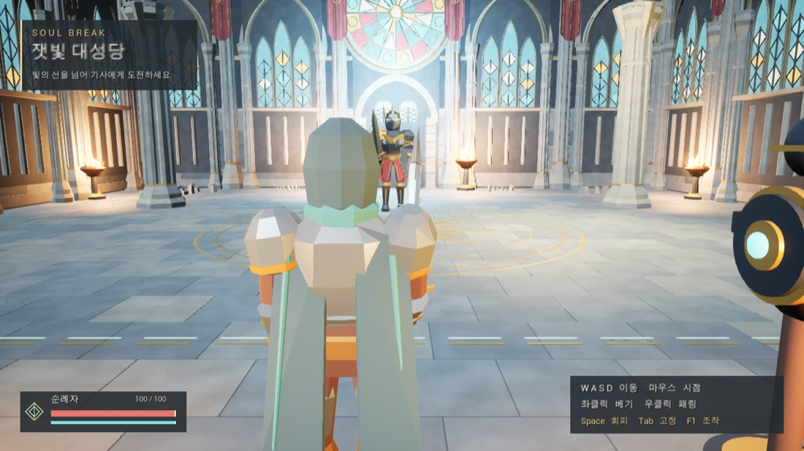
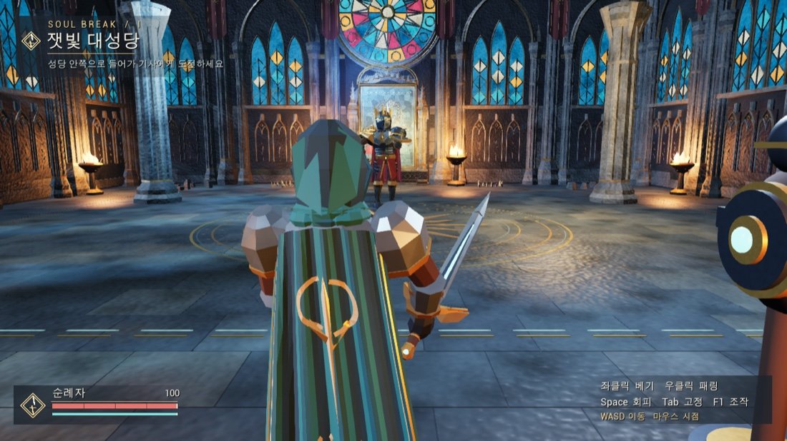

# SOUL BREAK · 조작과 화면 검증

UE 5.8.4, Apple Silicon M5 Pro 64GB, macOS 27.0.1에서 검사했다. 기존 빌드와 새 빌드 모두 실제 Enhanced Input 경로에 동일한 버튼 누름·뗌 이벤트를 보냈다.

## 공격 직후 입력

| 첫 베기 이후 입력 | 이전 패키지 | 개선된 패키지 |
|---|---|---|
| 약 0.20초에 두 번째 좌클릭 | 2타 미실행 | 입력을 기억하고 첫 베기 회복 완료 후 2타 실행 |
| 약 0.25초에 Space | 회피 미실행 | 유효 타격을 마친 뒤 회피 실행 |
| 약 0.45초에 우클릭 | 패링 미실행 | 남은 회복을 끊고 패링 실행 |

표의 세 사례는 30Hz와 60Hz 양쪽에서 재현했다. [동일 입력 비교 기록](input-response.json)은 고정된 시뮬레이션에서 콘솔 키 주입부터 상태가 관찰될 때까지의 시간이며, 명령 실행과 상태 조회에 드는 프레임도 포함한다. 별도의 컨트롤러 직접 주입 검사에서는 늦은 패링이 다음 게임 프레임에 시작했고, 타격 판정 중에 누른 회피는 해당 판정 종료를 기다렸다. 버튼 장치에서 화면까지의 물리적 지연은 측정하지 않았다.

## 성당 입구의 전후 화면

두 화면은 같은 입구에서 바라본 것이다. 새 화면은 압축 배포한 Mac Shipping 앱에서 캡처했다.

## 빌드와 플레이

- [에디터 30Hz](editor-30.json)와 [60Hz](editor-60.json), [Mac Development 패키지 30Hz](package-mac-30.json)와 [60Hz](package-mac.json)에서 각각 35개 통합 검사를 통과했다. 입력 중복과 우선순위, 자원 차감, 오른팔과 몸통 피해, 예고 중단, 패턴 선택, 승리·패배 후 재시작 각 10회를 검사했다. 승패·초기화의 반복 검사는 일부 위치·피해를 주입한다.
- [필수 전투 자동 테스트](unit-tests.json)는 중복 적중, 팔 파괴 1회, 사망 우선, 방어 시간창과 자원 소모를 검증한다.
- 19개 애니메이션이 같은 캐릭터 스켈레톤을 참조하는지, 길이가 유효한지와 성당의 입구에서 기사까지 내비게이션 경로가 연결되는지 확인했다.
- [시연 영상](../../Builds/Review/Demo/SoulBreak-Demo.mp4)은 Development 앱의 실제 입력·피해·애니메이션을 사용한다. 시연은 전투 상태를 직접 바꾸지 않는다. [이벤트와 음향 검수](mac-demo.json)
- [성능 측정](mac-performance.json)은 1080p Medium에서 팔이 부서진 2페이즈로 진입해 60초씩 세 번 실행했다. 성능 검사에서만 체력을 보충해 같은 상황을 유지했다. [Unreal Insights 원본](../../Builds/Review/Performance/phase2.utrace)
- [Shipping 검사](shipping-mac.json)는 앱의 독립 실행, 렌더링, 종료와 ZIP 압축 해제 후 서명 검사를 다룬다. Windows 실기 실행, Apple 공개 배포용 서명·공증은 미검증이다. [메뉴 검사](menu.json)는 기존 버전의 별도 검수 기록이다.

## 재현

`python3 Tools/build.py test`로 단위 테스트를 실행한다. Development 패키지에 `-SBAudit -SBAuditLook -benchmark -NullRHI -nosound -unattended -UseFixedTimeStep -FPS=60`을 전달하면 통합 검사를 재현할 수 있다. `python3 Tools/probe_input.py <실행파일> <빈 결과 폴더> --fps 30 60`으로 세 가지 동일 입력 사례를 재현할 수 있다. macOS 앱이 쓰는 결과 경로는 앱 컨테이너 안에 둔다.

이 수정은 기존 `a5fc9c2` 위의 작업 파일이다. 배포와 편집용 소스 ZIP을 연결하는 해시는 로컬 `Builds/Delivery.json`에 기록한다.
