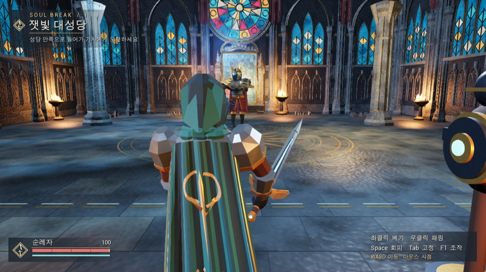
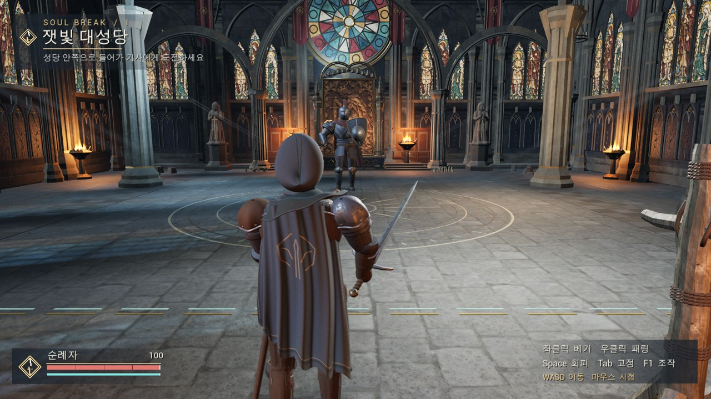

# SOUL BREAK 0.3.0 검증 기록

2026년 11월 12일, UE 5.8.4에서 잿빛 대성당의 세 부위 파괴, 여섯 공격 패턴, 교체된 캐릭터·장비·환경을 검증했다. Mac 테스트 장비는 Apple M5 Pro, 통합 메모리 64GB이다.

## 마우스 시점 수정

Mac의 AppKit 이벤트 큐에 버튼을 누르지 않은 좌우·상하 이동 6개를 보내 실제 카메라 회전값을 읽었다. 수정 전에는 0개, 수정 후에는 6개 모두 의도한 각도로 반영됐다. 비활성 창에서는 같은 6개 입력에도 시점이 유지됐다. 에디터와 개발 패키지에서는 자유 시점, 조작 수첩에서 복귀, 기사 고정 중 구도 조절을 확인했다. Shipping 앱은 두 번 새로 실행해 시작 시 기사 정면을 향하는지 확인했다. 이 검사는 자동 입력을 사용했고 Windows 실기와 물리 마우스·트랙패드 직접 조작은 미검증이다. [수정 빌드 입력 검증](mouse-look.json) · [Shipping 검사](shipping-mac.json)

아래 전투 영상과 성능 수치는 마우스 수정 직전 빌드에서 기록했다. 각 JSON에 해당 실행 파일의 해시를 남겼다.

## 전투

| 실행 환경 | 30Hz | 60Hz |
|---|---|---|
| Mac 에디터에서 게임 실행 | [43/43](editor-30.json) | [43/43](editor-60.json) |
| Mac Development 패키지 | [43/43](package-mac-30.json) | [43/43](package-mac.json) |

- [C++ 단위 테스트 5개](unit-tests.json)가 모두 통과했다. 중복 피해 방지, 파괴 이벤트 1회 처리, 사망 우선순위, 방어 시간창과 자원, 부위별 내구도와 반격 보너스를 확인했다.
- 실제 컨트롤러 키 이벤트로 Tab, F, 좌클릭, D를 입력했다. 방패 돌진을 옆으로 피한 뒤 첫 베기에 본체 20·방패 30 피해가 적용됐다. 돌진 경로 안에 서 있으면 28 피해가 한 번 발생했다. 무릎을 겨냥한 베기는 방패 내구도에 영향을 주지 않았다.
- 방패와 무릎 메시의 독립 뼈대가 숨겨지고 손과 정강이가 남는지 확인했다. 오른팔을 먼저 깨는 경로와 체력으로 2페이즈에 들어가는 경로, 사망·전환 우선순위, 종파의 안쪽 안전지대와 진행 중인 파면, 발구르기 봉쇄, 어깨치기를 검증했다.
- 각 실행에서 승리 후 10회, 패배 후 10회 재시작했다. 캐릭터 배치와 일부 마무리 피해는 테스트가 주입한다. 패키지 60Hz에서 회복 중 패링 입력은 다음 프레임에 관찰됐다. [동일 버튼 입력의 이전 버전 비교](input-response.json)
- [에셋 검사](armor-assets.json)에서 동일한 스켈레톤에 연결된 26개 시퀀스, 공격·파괴 효과음, 세 가지 떨어진 장비 메시, 갑주의 실제 PBR 맵 연결과 성당의 직선·기둥 우회 내비게이션 경로를 확인했다.

## 플레이 화면

이전 버전의 성당 입구

이번 빌드의 성당 입구

[실제 전투 영상](../../Builds/Review/Demo/SoulBreak-Demo.mp4)은 Mac Development 앱에서 78초간 촬영했다. 입력 시연은 검 피해, 보스 체력, 갑주 내구도를 직접 설정하지 않는다. 첫 전투에서 5.9초에 오른팔, 16.4초에 방패, 25.3초에 무릎 갑주가 깨진다. 49.1초에 승리하고 52.7초에 재도전 전투가 시작된다. [영상 이벤트와 오디오](mac-demo.json)

## 성능과 배포

[성능 기록](mac-performance.json)은 1080p Medium, VSync 해제, 화면 비율 100%로 2페이즈를 60초씩 세 번 실행한 결과다. 인게임 프레임 시간의 95백분위는 각 회차에서 14.00ms, 14.59ms, 14.42ms였다. 성능 측정 모드에서는 일정한 전투 부하를 유지하기 위해 체력을 보충한다. 세 회차를 저장한 뒤 Insights 추적을 켠 Development 프로세스가 엔진 종료 중 SIGSEGV로 끝났다. [Unreal Insights 원본](../../Builds/Review/Performance/phase2.utrace)

[Shipping 검사](shipping-mac.json)에는 앱 단독 실행, Metal 렌더링, 종료 상태와 배포 ZIP을 다시 풀어 확인한 결과가 들어 있다. Windows 실기 빌드·실행과 macOS 공개 배포용 공증은 미검증이다. [이전 메뉴 검수](menu.json)는 11월 3일 빌드에서 실행했다.

## 재현하기

`python3 Tools/build.py test`로 단위 테스트를 실행한다. Development 패키지 실행 인수에 `-SBAudit -SBAuditArmorAssets -SBAuditLook -benchmark -NullRHI -nosound -unattended -UseFixedTimeStep -FPS=60 -SBAuditOut=<결과 파일>`을 지정하면 갑주·입력·재시작 검사를 실행한다. Mac 패키지의 결과 경로는 앱 컨테이너 안에 둔다. Windows에서도 플랫폼에 맞는 게임 실행 파일을 사용한다.

`python3 Tools/review.py demo <Development 앱> <빈 결과 폴더> --ffmpeg <FFmpeg>`로 영상과 이벤트를 기록한다. 같은 도구의 `perf` 모드가 2페이즈 성능을 측정한다. 실행 ZIP·소스 ZIP·영상 해시는 로컬 `Builds/Delivery.json`에 기록한다.
