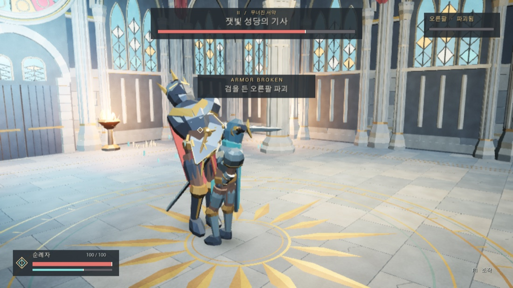

# SOUL BREAK · 잿빛 대성당

금빛 오른팔로 검을 치켜든 기사와 싸우는 싱글 플레이 3인칭 액션 게임. 팔 갑주를 깨면 검이 바닥으로 떨어지고 이미 예고한 참격도 끊긴다. 몸통만 공격해 체력을 절반으로 줄이면 같은 2페이즈에서도 기사는 검을 계속 쓴다.



## 플레이

Apple Silicon Mac에서는 **Builds/Shipping/Mac/SoulBreak-Mac-Shipping.app**을 실행한다. 개발용 패키지는 **Builds/Development/Mac/SoulBreak.app**이다. 에디터에서는 **SoulBreak.uproject**를 UE **5.8.4**로 열고 ▶ Play를 누른다. 기본 맵은 **L_Cathedral**이다.

입구의 훈련 표적에서 2연격을 연습할 수 있다. 성당 안쪽의 전투선을 넘으면 결투가 시작된다. 검 가로베기를 패링하면 **서약 절단** 한 번이 충전된다. 찬란한 금빛 갑주가 기사의 오른팔이다. 발구르기 예고가 보이면 바닥의 원에서 빠져나가거나 충격 순간에 맞춰 회피한다.

| 입력 | 동작 |
|---|---|
| W A S D · 마우스 | 이동 · 시점 |
| 왼쪽 Shift | 달리기 |
| Space | 이동 방향으로 회피 |
| 마우스 왼쪽 | 검 베기. 첫 공격 끝부분에서 한 번 더 누르면 2타 |
| 마우스 오른쪽 | 패링 |
| E | 패링 성공으로 충전된 서약 절단 |
| Tab | 기사 고정 또는 해제 |
| F1 · Esc | 조작 수첩과 일시정지. 에디터 플레이에서는 F1 |
| R · Q | 일시정지 또는 결과 화면에서 재도전 · 종료 |

## Mac과 Windows에서 개발하기

Mac에서 받은 **SoulBreak-UE5.8.4-Source.zip**을 Windows로 옮기는 경우 폴더 전체를 풀고 안의 **SoulBreak.uproject**를 연다. 이 ZIP에는 편집용 언리얼 에셋 원본이 포함돼 있다. Git으로 번갈아 작업하려면 아래의 LFS 절차를 사용한다.

두 컴퓨터에서 **UE 5.8.4**, **Git LFS**를 사용한다. 개발할 때는 각 컴퓨터의 네이티브 C++ 도구 모음이 필요하다. Mac에서는 전체 Xcode와 Metal 컴파일러가 필요하다. Win64에서는 Visual Studio의 **C++를 사용한 게임 개발**, MSVC와 Windows SDK를 설치한다. UE 5.8은 Visual Studio 2026 또는 Visual Studio 2022 17.14 이상을 지원한다.

처음 복제하기 전에 `git lfs install`을 실행한다. 저장소를 복제한 뒤 `git lfs pull`로 맵과 에셋을 내려받는다. 한 기기에서 에디터의 **Save All**을 누르고 커밋해 푸시한 뒤, 다른 기기에서는 에디터를 열기 전에 `git pull`을 한다. 첫 실행 시 해당 OS의 게임 모듈을 컴파일한다.

루트에서 다음 명령을 사용한다. Windows의 Python 런처에서는 `python3` 자리에 `py -3`를 사용한다. 엔진을 다른 곳에 설치했다면 `--engine "엔진 설치 폴더"`를 붙인다.

```sh
python3 Tools/build.py build
python3 Tools/build.py test
python3 Tools/build.py package
python3 Tools/build.py shipping
```

`package`는 현재 운영체제용 Development 패키지, `shipping`은 Shipping 패키지를 만든다. 결과는 `Builds/Development` 또는 `Builds/Shipping`에 생성된다. SDK·드라이버와 QA 결과는 [검증 기록](QA/Verification/README.md)을 참고한다.

## 전투 구조와 수정 위치

| 위치 | 책임 |
|---|---|
| `Source/SoulBreak/Private/Core` | 전투선, 대기·전투·승패, 일시정지, 레벨 재시작 |
| `Source/SoulBreak/Private/Player` | Enhanced Input, 이동, 카메라, 잠금, 체력과 스태미나 |
| `Source/SoulBreak/Private/Combat` | 시간창 내 검 궤적 스윕, 타격당 한 번 적용, 훈련 표적, 파편과 낙검 |
| `Source/SoulBreak/Private/Boss` · `AI` | 기사의 팔과 페이즈, 공격 취소, 거리·거리각 판정과 패턴 순환 |
| `Content/SoulBreak/Characters` | 영웅·기사 Blueprint, 직접 제작한 스켈레탈 메시와 공유 뼈대 |
| `Content/SoulBreak/Animations` | 대기·걷기·달리기, 검격과 역베기, 회피·패링·피격·사망, 기사 전용 패턴과 서약 절단 |
| `Content/SoulBreak/Data/DA_Combat` | 공격 비용·시간창·피해·사거리, 애니메이션과 효과음 참조 |
| `Content/SoulBreak/AI` | 기사 Behavior Tree와 Blackboard. C++ 상태에서 부위·페이즈·거리 키 동기화 |
| `Content/SoulBreak/Maps` · `Environment` · `Audio` | 독립적으로 저장된 성당 맵·건축물·재질, 합성한 효과음과 성당 앰비언스 |
| `Source/SoulBreak/Private/UI` · `Content/SoulBreak/UI` | 플레이 HUD, 키 안내, 마우스와 키보드로 조작하는 일시정지·결과 메뉴 |

첫 베기는 피해 20과 스태미나 15, 이어지는 두 번째 베기는 피해 30과 스태미나 20을 사용한다. 팔과 몸통이 한 궤적에 함께 걸리면 팔을 우선하고, 기사의 본체에도 같은 피해를 한 번만 준다. 팔 내구도 90, 보스 체력 400. 체력 200 또는 팔 파괴로 2페이즈에 진입한다. 마지막 타격에서 사망과 파괴가 겹치면 사망을 우선한다.

모델링·사운드 생성 원본은 `Tools/Art`, 언리얼 임포트와 게임 에셋 생성 도구는 `Tools/Editor`에 있다. 제작 스크립트를 재실행할 때만 Blender와 사운드 합성용 NumPy가 필요하다. 일반 플레이와 개발에서는 저장된 언리얼 에셋을 사용한다.
